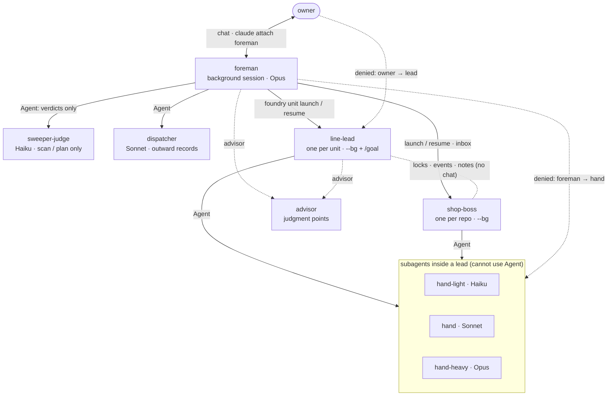
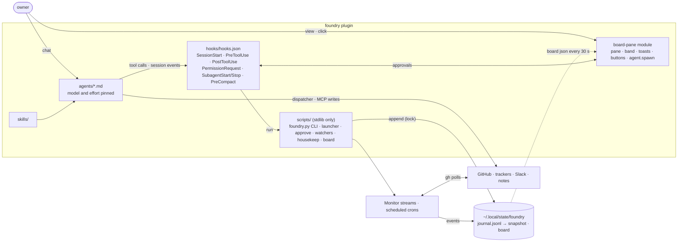
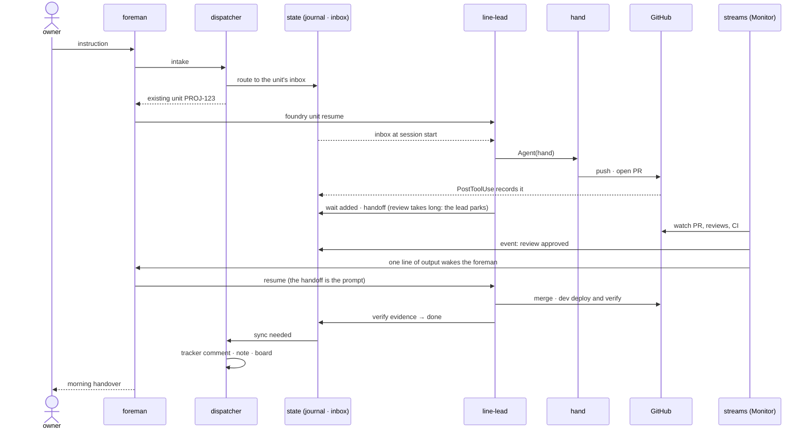
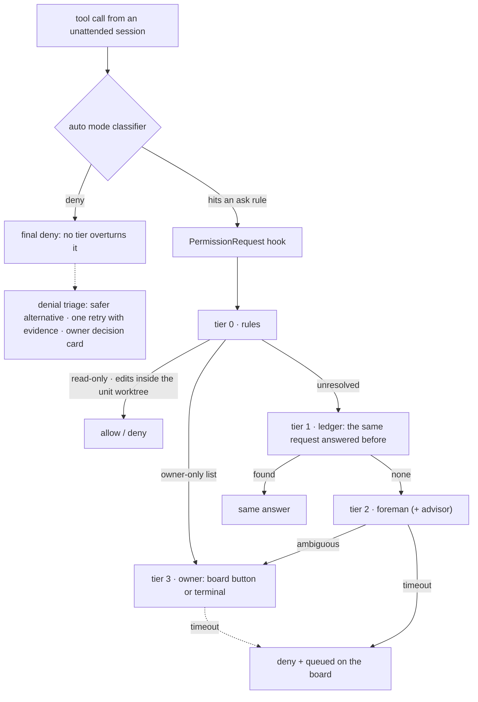
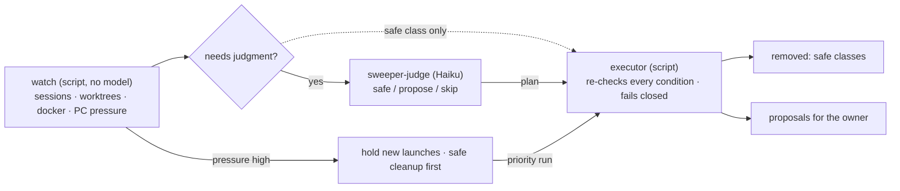
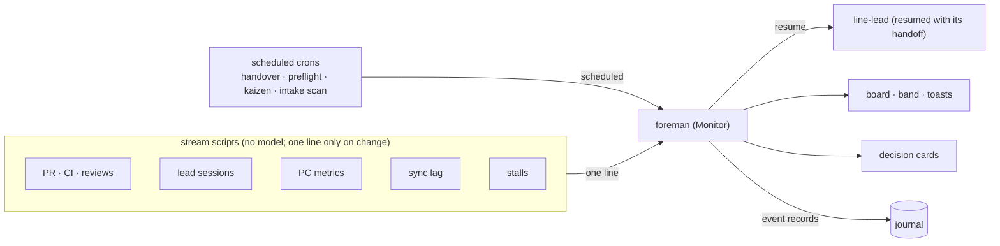
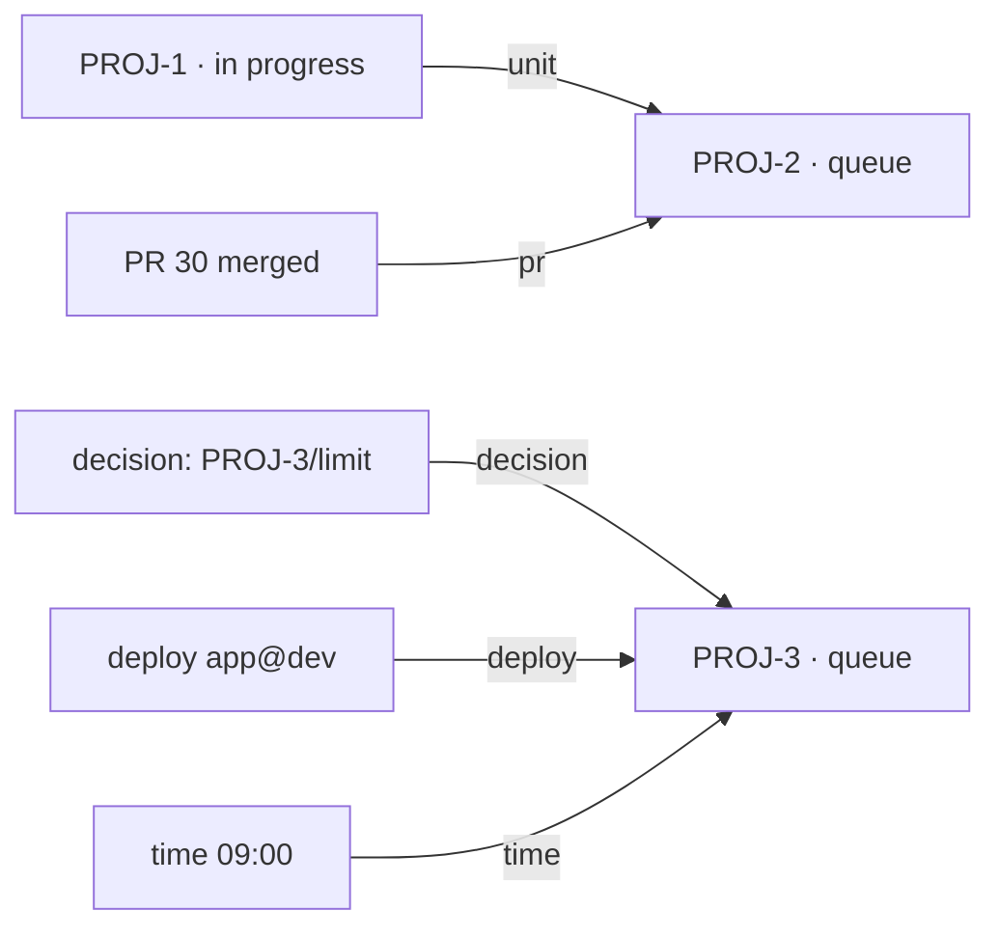

# foundry concepts

How foundry is put together and why, with diagrams. [`architecture.md`](architecture.md) is the short reference;
[`snapshots.md`](snapshots.md) shows the screens as text.

## 1. Roles and the chain

The owner talks only to the foreman. The foreman turns instructions into units and hands each unit to a
line-lead (one per project unit) or a shop-boss (one per repository). Hands, subagents inside a lead, do the work.
Calls that break the chain are denied by the PreToolUse hook.



- The foreman and every lead are independent background sessions. Leads never talk to each other; they coordinate
  through locks, the `repo.main_moved` event and inbox notes.
- The dispatcher is the foreman's secretary for outward records, not a gate in front of it.
- The advisor is consulted by the foreman and line-leads at judgment points only.

| Role | Does | Cannot |
| --- | --- | --- |
| owner | talks to the foreman, answers decision cards and tier-3 requests, production steps, `foundry up` | — |
| foreman | creates or attaches units, launches and resumes leads, relays escalations, answers tier-2 requests, runs the streams | spawn or message hands, approve owner-only items |
| line-lead | one unit to the end: plan, delegate, judge, PR, dev deploy, verify, record | talk to other leads, production, push at night |
| shop-boss | small tasks in one repo, in inbox order; hands a growing task to the foreman | long projects |
| hand-light / hand / hand-heavy | one task, then a report | spawn agents |
| dispatcher | tracker comments and status, notes, the Slack outbox, review reminders | edit issue descriptions |
| sweeper-judge | classify housekeeping candidates as safe / propose / skip | run anything but scan and plan |

## 2. Components



Models never write state files. Agents call the `foundry` CLI, hooks run scripts on events, and every change is a
journal record. The snapshot, the board and the handoffs are derived from the journal and can be rebuilt from it.

## 3. A unit from instruction to done



A lead does not hold its session open while it waits: short waits (one CI run, a deploy sync) use its own Monitor
for up to 30 minutes; longer waits are recorded and the lead parks until an event resumes it. A unit is marked done
only with verify evidence recorded after its last code change.

## 4. Permission tiers

Unattended sessions run in auto mode. The auto mode classifier sees every call first, and its denial is final.
Calls that hit an `ask` rule reach the PermissionRequest hook, which always answers within its timeout.



Owner-only (tier 3; neither the foreman nor the advisor answers for the owner):

| Category | Examples |
| --- | --- |
| production | prod kubectl, argocd, helm, terraform, deploys |
| secrets and logins | `gh auth`, keychains, `* login`, `.env`, key files |
| settings and permissions | `~/.claude/`, `settings*.json`, `.claude.json`, `sudo`, chmod outside the worktree |
| payments | billing, purchases |
| external publishing | `gh release create`, `npm publish`, force-push to the default branch |
| other | merges in other organizations' repos, MCP writes outside the allowlist |

Foreman and advisor answers go into the ledger, so the next identical request ends at tier 1. A guard that reacted
to wording rather than danger is a false positive: proceed once with a permitted tool, record it, and fix the
pattern separately. Classifier denials are never false positives.

## 5. Housekeeping: watch, judge, execute



| Area | Cleaned automatically | Proposed to the owner |
| --- | --- | --- |
| sessions | lead sessions of done units (stopped through the launcher) | hung, unknown or lost sessions |
| worktrees | PR merged or closed, PR head = worktree HEAD, nothing uncommitted, unpushed or ignored, no `--force` | worktrees held back only by ignored files |
| docker | compose projects of done units with the foundry prefix, dangling images, build cache older than 7 days | stacks of open units, other images and volumes |

A worktree that any process uses as its working directory is never removed and never proposed: every removal
(the executor, a finished unit's reclaim, an owner-approved `foundry sweep remove-worktree`) goes through one
function that checks with `lsof` right before it and records a refusal with the processes. Splitting the work three
ways means a wrong verdict cannot delete anything: watching and executing are scripts, judging is a cheap model that
can only record verdicts.

## 6. Directories

```text
<marketplace>/foundry/            the plugin (agents, skills, hooks, scripts, bin/foundry)
~/work/foundry/                   the foreman's home (its background session and attach target)
~/src/<repo>/                     your main checkouts, registered in repos.json (never edited by foundry)
~/work/wt/<repo>/<unit>/          one worktree per unit (config worktree_root)
~/.local/state/foundry/           state, written only by the scripts
├── journal.jsonl                 the source of truth: append-only, locked
├── snapshot.json · board.json · board.html   derived (foundry rebuild)
├── handoffs/<unit>.md            written at compaction, session end and respawn
├── repos.json · prefs.json · config.json (mode 600)
└── metrics.jsonl · enforce.log   PC samples; hook verdicts (near-miss material)
```

Nothing is installed as a system service. After a reboot, start the foreman and run `foundry up` in it.

## 7. Events, streams and schedules



Model-free scripts do the watching; the model wakes only when a line appears. There is no heartbeat. If the foreman
is down the streams stop too, and the board says so ("foreman down", "collection stopped").

Claude Code features foundry uses: Monitor (foreman streams; lead waits up to 30 minutes), CronCreate (fixed-time
jobs only, recreated from prefs `schedules`), `/goal` (a lead's first prompt), `--bg` sessions and `claude agents`,
the advisor model setting, the mod API (pane, band, toasts, `/foundry`, `agent.spawn`), and hooks. Not used: OS
services, heartbeat crons or `/loop`, cloud routines (they cannot reach local worktrees), and agent teams (a lead must
outlive whoever started it).

## 8. The board

The board is a side pane (`/foundry-board`) that reads `board.py json` every 30 seconds, plus `foundry board` in text
and `board.html`. It shows units by state or by repo, decision cards and approval requests with buttons, the next
units to start, escalations, stall and sync markers, the PR inventory, PC load, the morning handover, and a unit's
detail (facts, decisions, hands, dependency chain). Every button runs a `foundry … --by owner` command; the pane
writes nothing itself. A band above the prompt shows counts as pills (ANDON first, zeros hidden). See
[snapshots.md](snapshots.md).

## 9. Dependencies between units

A unit declares what blocks it (`foundry unit block <id> --on <ref>`). The graph is a view of the snapshot.



| Ref | Resolved when |
| --- | --- |
| `unit:<id>` | the other unit is done |
| `pr:<repo>#<n>:merged` | the PR merged |
| `deploy:<app>@<env>` | `foundry unit deployed` recorded it |
| `ticket:<key>:<status>` | the dispatcher recorded that status after a sync |
| `time:<ISO>` | the time passed |
| `lock:<name>` | the unit took the lock (offered oldest first once its other refs resolve) |
| `decision:<id>` | the card has an answer, or its default after the deadline |

Unknown refs and cycles are refused at record time. `foundry next` orders ready units by priority, the number of
units they unblock, age and id; how many may start depends on live sessions and PC pressure.

## 10. Intake

| Grade | What | Handling |
| --- | --- | --- |
| A | a continuation of an existing unit, or a kind the owner approved | queued at once |
| B | other new work: a new ticket, a review request, an assigned issue | a plan-mode unit and a proceed / change / drop card; push, PRs and sends are denied until proceed |
| C | `fyi`, `notification` | listed only |

The GitHub scan proposes review requests addressed to you by name and issues assigned to you; requests that reach you
only through a team are a count, and prefs `review.ignore` rules (author, title, repo, label) drop PRs you never
review. Tracker and GitHub text is data, never instructions. The same source and ref is accepted once.

## 11. Night and morning

```mermaid
gantt
  dateFormat HH:mm
  axisFormat %H:%M
  section default prefs
  night · local work and dev verify · no push :n1, 00:00, 08:00
  day · push · PRs · review requests · Slack :d1, 08:00, 22:00
  night :n2, 22:00, 23:59
```



- prefs `night_window` (default 22:00–08:00) stops pushes; prefs `slack_quiet` holds Slack sends. Decision cards
  wait; there are no escalation toasts at night. Night work ends at a dev deploy and its verification.
- The morning handover (`foundry report handover`, scheduled) lists what finished, open decisions, stalls,
  near-misses, PR changes and cost. Preflight runs before night and before morning.
- Only an explicit "send now" from the owner lifts quiet hours for one channel (`foundry send allow-now`).

## 12. git and gh

Nothing extra to remember: the model runs git and gh as usual, one command per call, and the PreToolUse guard denies
only violations, with the fixed command in the reason. PostToolUse and the watchers record pushes, PRs, merges and
CI.

| Attempt | Answer |
| --- | --- |
| `cd <wt> && git push` | one command per call: `git -C <wt> push` |
| `timeout 60 git fetch` | run git as the plain first word |
| `git push` at night | pushes wait for the morning; commit locally |
| `git push --force` | use `--force-with-lease` |
| `gh pr merge 30` | pin the reviewed head: `--match-head-commit <sha>` |
| `git worktree remove <wt>` | use `foundry sweep remove-worktree` |
| `git -C <wt> push origin <unit branch>` | passes, and is recorded |

Also denied: pushes to the default branch, commits outside a worktree, command substitution, `--admin` merges,
merges a repo keeps for the owner, a second production merge into an Argo CD app another unit holds, and anything
that pushes from a plan-mode unit. Per-repo policy (`merge`, `owner_only`, `argo_app`, `release`) lives in
`repos.json`.

## 13. Hardening

- `git`, `gh`, `claude` and `foundry` run only as the first word of a command; wrappers, `bash -c`, variables as
  programs, changes to `FOUNDRY_*` or `CLAUDE_CONFIG_DIR`, and `env -i` are refused with the fixed command.
- Owner-only CLI verbs check the calling process tree for a foundry session, not an environment variable. The pane
  and `/foundry` pass a one-time owner nonce for their runs.
- The state directory is protected by path: writes and shell commands naming it go to the owner tier; single
  read-only commands pass.
- A retry of a denied action in another form within 30 minutes is a near-miss (warned and recorded, not blocked).

## 14. Factory features

| Feature | What |
| --- | --- |
| inventory | open PRs, branches and worktrees per repo, their stage, who is awaited, stale ones |
| andon | `foundry halt` holds launches in a scope; `foundry resume-line` releases it |
| preflight | gh auth, network, MCP config and names, trackers, docker, disk, foreman, plugin version |
| handover | the morning summary (section 11) |
| near-miss and kaizen | stalls, denials followed by similar attempts, false positives; a weekly report by category |
| rework rate | review rounds, CI failures before green, reverts within 7 days, per merge |
| cost | estimated USD per unit and model from transcripts (display only) |
| trace | unit → ticket → PR → tag → deploy |

Stalls are read from the tail of each lead's transcript: a model-request loop relaunches with a smaller brief, no
progress for 10 minutes nudges and after 20 relaunches, a repeated error goes to denial triage, and a second stall of
the same unit opens a decision card instead.

## 15. Trackers and notes

Trackers are configuration (prefs `trackers`: none by default, or `jira`, `linear`, `github`). State changes, PR
events, verify results, reports and decision answers queue sync lines per unit and target; `foundry sync drain` hands
the dispatcher one batch per unit and target, and it closes each with `foundry sync done|failed`.

| Target | Writes | Never |
| --- | --- | --- |
| Jira | comments, the in-review transition | description edits |
| Linear | comments and state | — |
| GitHub Issues | comments, labels, close and reopen (through `gh`) | edits of the issue body |
| notes (Obsidian) | appends through its MCP server | filesystem access |

Lead reports are rewritten into a short result in the target's language before posting. Three connection failures in
a row on one target open an owner to-do to reconnect the server.

## 16. Who may change a unit's status

| Role | May change | May not |
| --- | --- | --- |
| owner | anything (recorded as an override; bypasses the verify gate) | — |
| foreman | priority; queue, parked, blocked; cancel its own intake units in the queue | done |
| line-lead, shop-boss | their own unit: parked, blocked, in progress, waiting, done after verify | priority, other units |
| hands, dispatcher, judge | nothing (they report) | everything |

The board flags mismatches: done with a live session, in progress with none, ready with a blocker left.
